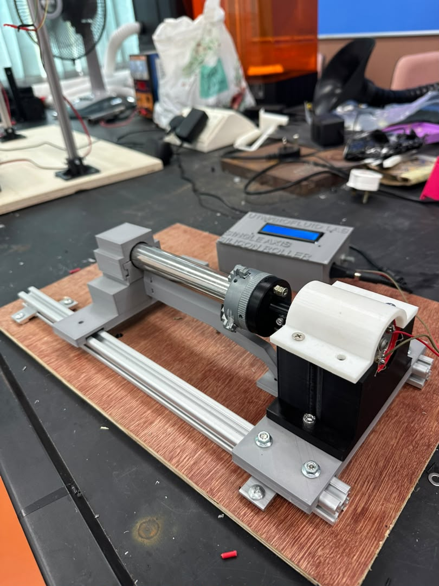
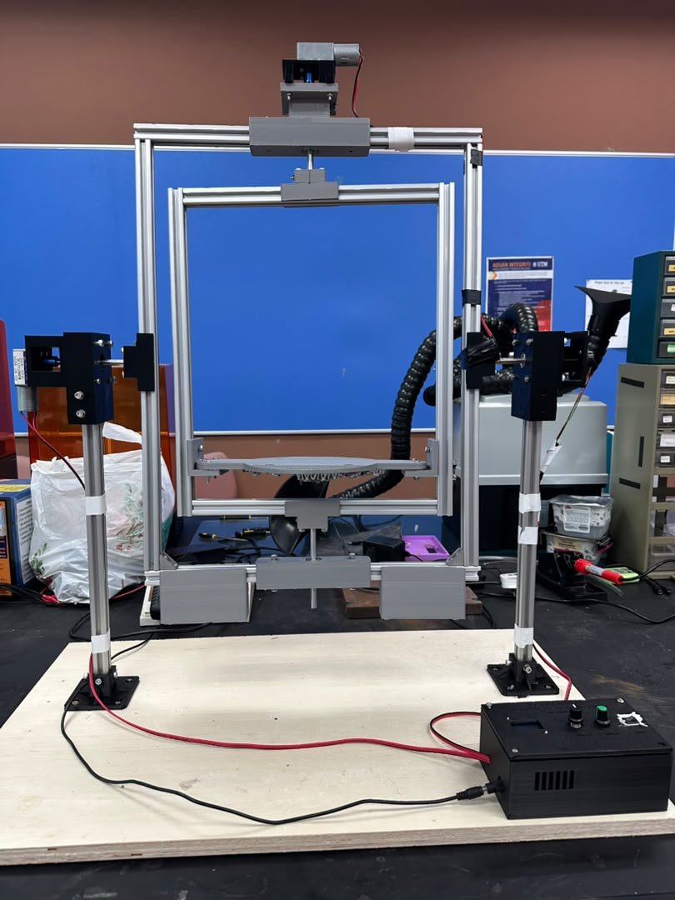

# Project Details, Recommendations and SOP

Two silicone mould casting devices built at the Biofluid Laboratory (Dr. Zahran Lab), Universiti Teknologi Malaysia, 20 July to 9 October 2026. Documentation issued 18 October 2026; final photos taken 6 November 2026.

- **Project 1:** Single-Axis Silicone Mould Roller Upgrade (report TR-BFL-RLR-01, SOP SOP-BFL-RLR-01)
- **Project 2:** Dual-Axis Silicone Mould Rotating Device, the "rotocaster" (report TR-BFL-ROT-01, SOP SOP-BFL-ROT-01)

The full technical reports and SOPs are in each project's `docs/` folder. This file summarises them.

---

## Contents

1. [Project 1: Single-Axis Silicone Roller](#project-1-single-axis-silicone-roller)
2. [Project 2: Dual-Axis Rotocaster](#project-2-dual-axis-rotocaster)
3. [Recommendations](#recommendations)
4. [SOP summary: Single-Axis Roller](#sop-summary-single-axis-roller)
5. [SOP summary: Dual-Axis Rotocaster](#sop-summary-dual-axis-rotocaster)
6. [Lessons learned](#lessons-learned)

---

## Project 1: Single-Axis Silicone Roller

### Brief

Upgrade the laboratory's existing silicone mould rotating device into a market-ready unit with better safety, reliability and user interface, and document it with an SOP (written and visual) and a technical report.

### Product design specification and status

| ID | Requirement | Design response | Status |
|---|---|---|---|
| a | Single-axis rotation | Mould carried on a stainless-steel roller tube turning about one horizontal axis | Met |
| b | Smooth operation up to 100 RPM | Motor in line with the roller on a cradle seat; positive shaft clamp | Built; top speed to be confirmed with a tachometer |
| c | Intuitive speed control | One speed knob next to the display | Met |
| d | Wall-socket power | Wall-socket adapter; low-voltage DC inside the device | Met |
| e | ON/OFF on a dedicated operator panel | ON/OFF switch on the control enclosure | Met |
| f | Display of RPM and status | Display behind the enclosure window | Met; accuracy to be confirmed with a tachometer |
| g | 3D-printed or equivalent materials | PLA parts on an aluminium rail and plywood base | Met |

### Design

- **Layout:** an aluminium T-slot extrusion rail on a plywood base. Every part (control enclosure, bearing support, roller, motor bracket) clamps to the rail with T-nuts, so parts can be slid and re-aligned for different moulds without new parts.
- **Control enclosure:** 3D-printed, engraved "UTM/BIOFLUID LAB, SINGLE AXIS SILICON ROLLER", with the ON/OFF switch, speed control and display grouped on one panel. Placed at the far end of the rail from the mould to keep spills away from it.
- **Motor seat:** 79 × 59 × 56 mm printed block with a semicircular cradle that keeps the motor shaft in line with the roller axis.
- **Hub disc (the main redesign):** the old resin hub relied only on the fit of its D-bore and worked loose. The new hub was developed in a browser-based parametric tool (sliders for every dimension, collision warnings, cut-away view, STL export) and refined against measurements of the real part.

| Hub disc feature | Dimension |
|---|---|
| Disc body | Ø47 × 10 mm |
| Front hub | Ø18 mm × 20 mm |
| D-bore | Ø6.2 mm, 5.7 mm across the flat (0.2 mm clearance on a 6 mm D-shaft) |
| Shaft clamp | M3 × 6 grub screw with a captive M3 nut |
| Back | 4 ring segments, 4.5 mm tall, around a Ø29 mm hollow; 2 × Ø3.8 mm holes to the chuck |
| Mass | About 24.6 g if printed solid in PLA |

### Choosing a speed

The speed at which centrifugal acceleration at the mould wall equals gravity is

nc = (60 / 2π) √(g / r) ≈ 29.9 / √r  (rpm, r in metres)

Below nc the silicone tumbles over the wall; well above it the silicone is held as an even film around the circumference.

| Mould inner radius (mm) | 10 | 20 | 30 | 50 | 75 | 100 |
|---|---|---|---|---|---|---|
| Reference speed (rpm) | 299 | 211 | 173 | 134 | 109 | 95 |

### Acceptance tests

| Test | Method | Pass criterion |
|---|---|---|
| T1 Inspection | Pre-use inspection; check every clamp and screw | All checks pass |
| T2 Speed and display | Tachometer at min, 25, 50, 75 % and max knob | Max ≥ 100 RPM; display within ±5 % |
| T3 Smoothness | Watch for wobble, listen for knocking at each T2 speed | None |
| T4 Endurance | 60 min at casting speed with a filled mould | No slip, loosening, heating or noise |
| T5 User trial | New user runs the device from the visual SOP only | No help needed |
| T6 Casting trial | Cast a tube; measure wall at 6 points | Within the model's tolerance |

---

## Project 2: Dual-Axis Rotocaster

### Brief

Develop a device that rotates a mould holder through 360° about two perpendicular axes to prevent silicone dripping, with two independent motor-driven shafts, a control panel and a status display, plus technical documentation and an SOP.

### Main specifications

| Item | Specification |
|---|---|
| Layout | Nested-box gimbal; the mould sits where the two axes cross |
| Frame | 2020 aluminium extrusion with gusset brackets; outer frame 468 × 536 mm, inner frame 360 × 416 mm |
| Mould envelope | Ø300 × 300 mm; 5 kg with the fitted motors, 10 kg with a 70 kg·cm motor |
| Drives | 2 × JGY-370 worm gearmotors, 12 V, 18 rpm no-load, 13 kg·cm, self-locking |
| Shafts and bearings | Ø8 mm hardened steel with D-flats; 608ZZ bearings in printed housings |
| Power to inner motor | 6-wire capsule slip ring; wires run through a hollow trunnion, so the cable cannot wind up |
| Counterweight | Two pockets of M8-nut ballast on the bottom rail at ±120 mm |
| Base | 750 × 450 × 18 mm plywood |
| Rotating mass | About 5.35 kg without mould |
| Printed parts | About 2 kg of PLA, all generated from one CadQuery model |
| Cost | About RM 464 mechanical plus about RM 50 of electronics |

### Design approach

- **Concept:** a nested-box gimbal was chosen over an offset-arm or rock-and-roll machine because it keeps the mould on both axes, so unbalance is small and both axes turn a full 360°.
- **Parametric CAD:** one CadQuery (Python) script generates every part from one set of parameters and exports the STLs. When the 180 mm rails arrived at 184 mm, one clearance parameter absorbed the difference without changing any printed part. A Fusion 360 assembly confirmed both frames turn through 360° without interference.
- **Mould interface standard:** mould foot on a Ø140 mm PCD (4 × M6) on a plate slotted ±6 mm for balancing; lid on a Ø280 mm PCD (6 × M5); Ø45 mm pour port with a retained, O-ring sealed plug that cannot fall out when inverted.
- **Interactive 3D model:** `cad/rotocaster_3d_viewer.html` lets you turn both axes with sliders and names each part on hover.

### Engineering analysis

Torque required = unbalance + acceleration + bearing friction + fluid shear.

- Combined centre of gravity sits 20.5 mm above the outer axis, giving a permanent unbalance torque of **1.076 N·m** (85 % of the motor rating) before any mould is fitted. The main cause is Motor 2 (162 g at 268 mm from the axis).
- Counterweight needed: **409 g**, split into two pockets of about 204 g.
- Acceleration (15 s ramp to 20 rpm, 10 kg mould): 0.061 N·m. Bearing friction about 0.001 N·m; silicone shear below 0.01 N·m.
- A 10 kg mould with only 10 mm of offset needs about **1 N·m**, close to the 1.27 N·m motor rating. **The machine is limited by balance, not by motor power.**

| Mould mass | 10 rpm | 20 rpm | 30 rpm | 100 rpm |
|---|---|---|---|---|
| 2 kg | 0.22 N·m | 0.24 N·m | 0.26 N·m | 0.40 N·m |
| 5 kg | 0.51 N·m | 0.54 N·m | 0.56 N·m | 0.73 N·m |
| 10 kg | 1.01 N·m | 1.04 N·m | 1.07 N·m | 1.28 N·m |

**Why not 100 rpm?** A worm gearmotor's torque falls about fifteen times between 10 and 100 rpm (0.15 N·m at 100 rpm, not enough to start the empty gimbal). And above about **77 rpm** (for r = 0.15 m) the silicone is pinned to the wall and the process becomes centrifugal casting, with thick walls at the equator and thin poles. The recommendation is a load chart at 10 to 20 rpm instead of a single 100 rpm target.

Other load-bearing parts have large margins: bearings 45×, PLA at the D-flats 16×, shaft bending 21×, slip ring current 5.7×. The motor is deliberately the weakest link: a stalled motor stops the machine, whereas a failed bracket would drop the mould.

### Electronics and firmware

| Arduino pin | Connected to | Function |
|---|---|---|
| D5 (PWM), D7, D8 | L298N ENA, IN1, IN2 | Motor 1 (outer axis) speed and direction |
| D6 (PWM), D9, D10 | L298N ENB, IN3, IN4 | Motor 2 (inner axis) speed and direction |
| A0, A1 | Potentiometers | Outer and inner speed settings |
| D2 | ON-OFF-ON rocker to GND | RUN/STOP, internal pull-up |
| A4, A5 | 1.3" 128×64 OLED | I2C display (U8g2 library) |
| Vin, GND | 12 V adapter through a 2 A fuse | Power, common ground |

The sketch (`firmware/rotocaster_controller/rotocaster_controller.ino`) runs a 20 ms loop: it averages 8 pot readings, maps them to PWM 60 to 255 with a dead band, ramps to full speed over 15 s using real elapsed time, stops immediately on STOP or pot at zero, and never holds a running motor below the minimum PWM so it cannot sit stalled. The OLED shows RUN/STOP, duty and estimated rpm per axis every 300 ms. `SWAP_POTS`, `SWAP_MOTORS` and `SWAP_SCREEN` flags fix wiring mix-ups in software.

The 3D-printed control box (166 × 96 × 63 mm, designed in CadQuery) has board standoffs, a USB opening, vents for the L298N, and an engraved lid with OLED window, OUTER and INNER knobs and the RUN switch.

### Build, faults and commissioning

- 19 faults were logged and each was fixed in the CAD source, not by hand. Examples: a bearing bore on the wrong axis, a mould plate 340 mm wide for a 320 mm opening, a pour plug with no retention, and a Motor 2 coupler that could not be reached (fixed by rebuilding the top bridge with a second bearing and a new standoff).
- A bearing fit gauge was printed first, and the bearing bore set to 22.2 mm from its result.
- **First powered test:** the frame was counterweight-heavy, Motor 1 stalled lifting the ballast over the top and burnt out within seconds. Ballast was reduced to near-neutral balance, the motor replaced, and both axes then ran under independent speed control.
- Staged commissioning: upload with motors unplugged, check 12 V for shorts, power with motors disconnected, run each motor off the frame on a 0.5 A current-limited supply, then one axis at a time.

### PDS compliance

| ID | Requirement | Status |
|---|---|---|
| a | Dual-axis 360° rotation | Met |
| b | Smooth operation up to 100 RPM | Justified deviation: 15 s soft start, 18 rpm top speed; 100 rpm is above the 77 rpm casting limit |
| c | Precise speed control | Partly met: repeatable but open-loop |
| d | Wall-socket power | Met |
| e | ON/OFF on operator panel | Met |
| f | Display of RPM and status | Partly met: rpm is estimated from duty cycle |
| g | 3D-printed materials | Met |
| h | Quick-release mould mounting | Partly met: bolt-on, minimal effort, not tool-free |
| i | Mould Ø300 × 300 mm, 2 to 10 kg | Partly met: 5 kg with fitted motors |
| j | No cable wind-up, no dripping | Met by design |

---

## Recommendations

### Single-axis roller

1. Run acceptance tests T2 to T6 and record the results before routine use (top speed and display accuracy with a tachometer).
2. Fit a clear guard over the chuck and hub, an inline fuse, cable strain relief where the cables enter the enclosure, and rating and warning labels.
3. Archive the CAD and STL files of all printed parts with the report and SOP on the laboratory drive.
4. Record the best speed for each mould on its casting sheet, building a reference for future users.
5. Review the SOP after one month of use and update it with user feedback.
6. Keep a spare printed hub disc and inspect PLA parts monthly for creep and wear.

### Dual-axis rotocaster

1. Weigh and balance the first real mould, cast a part and record the wall thickness at several points.
2. Keep moulds at 5 kg or less, or fit 16 rpm, 70 kg·cm worm gearmotors (safety factor 6.8 at 10 kg) for heavier moulds.
3. Add current limiting or a fuse for each motor (or a driver with current sensing and stall detection), and a panel power switch on the 12 V input.
4. Fit an encoder or Hall sensor on each axis, close the speed loop and display the measured speed (PDS c and f).
5. Add captive thumb screws or a quarter-turn clamp to the mould plate for tool-free mounting (PDS h).
6. Add a guard around the frame (ideally one that stops the machine when opened) and rating and warning labels.
7. Revise the PDS speed item to 0 to 20 rpm with the load chart in the SOP.
8. Reprint printed parts in PETG or ABS if heat-cured silicone or an oven cure is planned (PLA softens at about 60 °C).

---

## SOP summary: Single-Axis Roller

Full document: [SOP_Single-Axis_Silicone_Roller.pdf](single-axis-roller/docs/SOP_Single-Axis_Silicone_Roller.pdf). Visual poster: [Visual_SOP_Poster_Single-Axis_Roller.png](single-axis-roller/docs/Visual_SOP_Poster_Single-Axis_Roller.png).

**PPE:** nitrile gloves, safety glasses, lab coat with sleeves fastened, closed shoes, long hair tied back.

**Main hazards:** entanglement at the rotating roller, chuck and hub; pinch points; mould coming loose; silicone on skin or eyes; electrical faults if liquid reaches the enclosure.

1. **Pre-use inspection (OFF and unplugged):** base flat; cable undamaged; rail clamps tight; hub grub screw on the shaft flat and chuck screws tight; roller turns freely through two turns by hand; switch OFF and speed knob at minimum.
2. **Prepare silicone:** read the TDS (mix ratio, pot life, gel and cure time); weigh both parts; mix fully; de-gas if possible.
3. **Fill and mount:** pour, close and seal the mould; wipe the outside; secure it centred on the roller; turn one full turn by hand to check clearance.
4. **Start-up:** switch OFF and knob down, plug in; switch ON; raise the speed slowly to the set speed; watch the first turns.
5. **Run:** stay for the first 5 minutes; avoid sharp speed changes; keep turning until the gel time has passed.
6. **Shutdown:** knob to minimum, switch OFF, unplug; remove the mould; demould after the cure time; record the result.
7. **Clean:** OFF and unplugged; wipe silicone with dry wipes then isopropyl alcohol; keep liquids away from the enclosure.

**Emergency:** switch OFF and unplug; never stop the roller by hand; tag "OUT OF SERVICE" and report.

**Maintenance:** inspection before every run; clean after every run; monthly clamp, hub and printed-part check; 6-monthly tachometer check of the display.

---

## SOP summary: Dual-Axis Rotocaster

Full document: [SOP_Dual-Axis_Device.pdf](dual-axis-rotocaster/docs/SOP_Dual-Axis_Device.pdf). Visual poster: [Visual_SOP_Poster_Dual-Axis_Rotating_Device.png](dual-axis-rotocaster/docs/Visual_SOP_Poster_Dual-Axis_Rotating_Device.png).

> **Warning:** worm gearmotors stall silently and burn out within seconds if a frame is unbalanced or blocked. Balance every new mould before power is applied, and switch to STOP at once if a frame stops while powered.

**Limits:** mould ≤ 5 kg with fitted motors; recommended 10 to 15 rpm per axis (different speeds on each axis); never above about 77 rpm; 0.5 m keep-out zone around the machine.

1. **Pre-use inspection (STOP, unplugged):** level bench with 0.5 m clear; posts locked in their sockets; brackets, grippers and shelves tight; counterweight nuts clamped and covers fitted; slip-ring wires secure; fuse fitted; switch on STOP, both knobs at zero.
2. **Mount and balance:** weigh the mould (≤ 5 kg); bolt the foot to the plate (4 × M6); lock the inner frame, disengage the outer drive, turn the outer frame to 90° and release it. If it swings, adjust the M8-nut ballast (same count on both sides) until it holds at 90° and 0°. Then balance the inner frame by sliding the plate in its ±6 mm slots. Re-engage both drives.
3. **Fill:** fit the lid (6 × M5, star pattern); pour through the port; fit the pour plug with O-ring and 3 × M4; wipe the mould clean.
4. **Start-up:** STOP and knobs at zero, plug in (OLED shows the splash, then STOP); switch to RUN; raise INNER slowly, then OUTER; watch the first five revolutions from outside the keep-out zone.
5. **Run:** keep turning for at least the gel time; check regularly.
6. **Shutdown:** STOP and knobs to zero; unplug; demould after the cure time; record the speeds and result.
7. **Clean:** STOP and unplugged; wipe with dry wipes then isopropyl alcohol; keep liquids away from the control box, motors and slip ring.

**Counterweight rule:** if Motor 2 (top) swings down, add nuts; if the counterweights swing down, remove nuts. A counterweight-heavy frame is what burnt out Motor 1 in the first test.

**Emergency:** STOP and unplug; never force a frame by hand (loosen the coupler to free it); after a stall, re-balance and test the motor on a current-limited supply; tag "OUT OF SERVICE" and run the commissioning procedure before reuse.

**Maintenance:** inspection and balance before every run; clean after every run; monthly screw, grub-screw and bearing check; 3-monthly printed-part and slip-ring wiring check (about 0.35 A running current).

---

## Lessons learned

- Check a requirement such as "100 rpm" against both the drive and the physics of the process before accepting it.
- A design that is correct on screen can still fail because a supplier's part differs from its listing, a printed hole comes out undersize, or the real frame balances differently from the model. Check every delivered part and print a fit gauge first.
- Fix faults in the parametric source, not by hand, so the CAD and the hardware stay in step.
- Test new drives on a current-limited supply with a balanced load, one axis at a time.

## References

- Crawford, R. J., & Throne, J. L. (2002). *Rotational molding technology*. William Andrew Publishing.
- Budynas, R. G., & Nisbett, J. K. (2015). *Shigley's mechanical engineering design* (10th ed.). McGraw-Hill.
- Hibbeler, R. C. (2016). *Engineering mechanics: Dynamics* (14th ed.). Pearson.
- IEC 61010-1:2010+A1:2016. Safety requirements for electrical equipment for measurement, control, and laboratory use.
- STMicroelectronics. L298 dual full-bridge driver datasheet.
- CadQuery documentation: https://cadquery.readthedocs.io/
- U8g2 library: https://github.com/olikraus/u8g2
