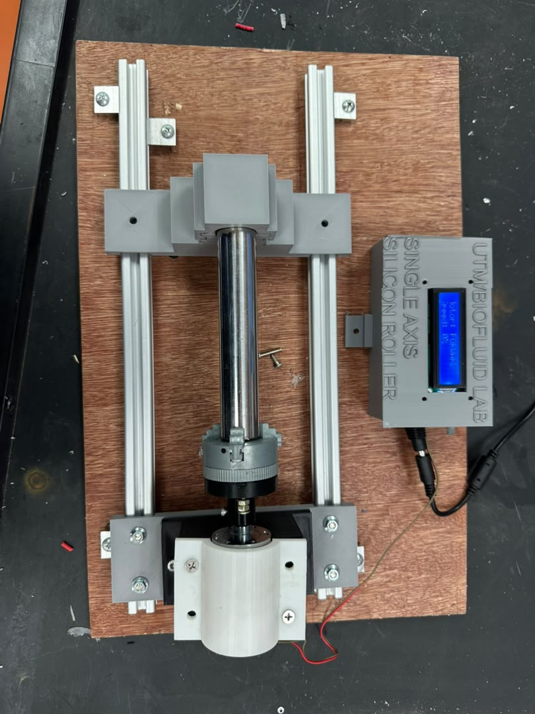
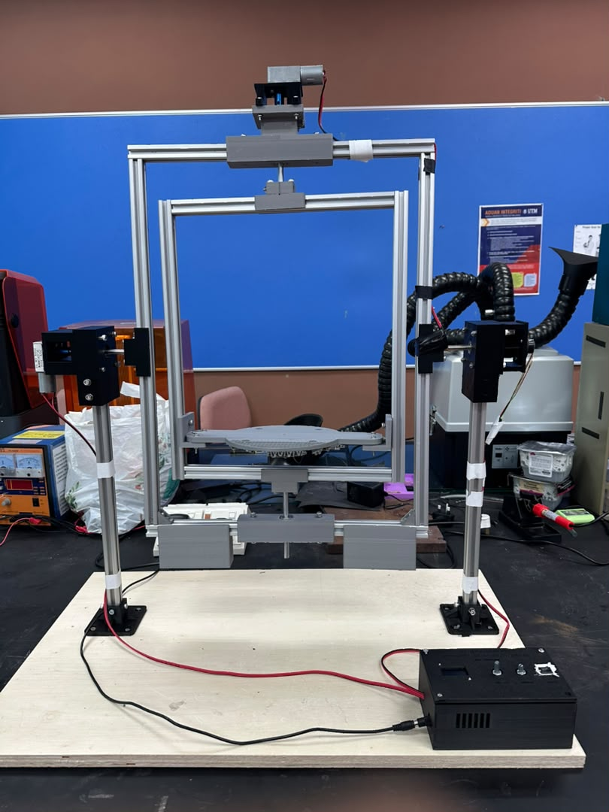

# Silicone Mould Casting Devices: Single-Axis Roller and Dual-Axis Rotocaster

Two bench-top machines for casting hollow silicone models (blood vessels, aneurysms, organ chambers), designed and built during my industrial training at the **Biofluid Laboratory (Dr. Zahran Lab), Department of Biomedical Engineering and Health Sciences, Faculty of Electrical Engineering, Universiti Teknologi Malaysia (UTM)**, under the supervision of Dr. Ahmad Zahran Md Khudzari (July to October 2026).

| | Single-Axis Silicone Roller | Dual-Axis Rotocaster |
|---|---|---|
| Photo |  |  |
| What it does | Turns a tubular mould about one axis so silicone coats the wall evenly | Turns a closed mould through 360° about two perpendicular axes, so silicone coats every part of the wall |
| Main work | Upgrade of the lab's old roller: rail-mounted layout, labelled control enclosure, redesigned motor hub | New machine: parametric CAD, torque and balance analysis, Arduino controller, about 2 kg of 3D-printed parts |
| Key numbers | Hub disc Ø47 × 10 mm with M3 grub-screw clamp on a 6 mm D-shaft | Mould Ø300 × 300 mm, 15 s soft start, built for about RM 464 plus RM 50 of electronics |
| Documents | [SOP](single-axis-roller/docs/SOP_Single-Axis_Silicone_Roller.pdf) · [Technical report](single-axis-roller/docs/Technical_Report_Single-Axis_Silicone_Roller.pdf) · [Visual SOP](single-axis-roller/docs/Visual_SOP_Poster_Single-Axis_Roller.png) | [SOP](dual-axis-rotocaster/docs/SOP_Dual-Axis_Device.pdf) · [Technical report](dual-axis-rotocaster/docs/Technical_Report_Dual-Axis_Device.pdf) · [Visual SOP](dual-axis-rotocaster/docs/Visual_SOP_Poster_Dual-Axis_Rotating_Device.png) |

**Full write-up:** [PROJECT_DETAILS.md](PROJECT_DETAILS.md) has the design, analysis, results, recommendations and an SOP summary for both machines.

**Demo video:** [media/demo_video.mp4](media/demo_video.mp4)

## Why rotational casting?

Hollow silicone models are made by pouring a measured amount of liquid silicone into a closed mould and turning the mould while the silicone gels. The silicone coats the inner wall and leaves a hollow part with a controlled wall thickness, without a core. A straight tube only needs rotation about its own axis (the roller). A closed 3D shape such as an aneurysm or a heart chamber needs rotation about two axes (the rotocaster).

## Repository layout

```
silicone-casting-devices/
├── README.md                     this page
├── PROJECT_DETAILS.md            full details, recommendations and SOP summary
├── media/demo_video.mp4
├── single-axis-roller/
│   ├── docs/                     SOP, technical report, visual SOP poster (PDF/PNG)
│   ├── cad/                      hub disc and motor seat STLs, parametric hub tool (HTML)
│   └── photos/
└── dual-axis-rotocaster/
    ├── docs/                     SOP, technical report, visual SOP poster (PDF/PNG)
    ├── firmware/                 Arduino controller sketch
    ├── cad/
    │   ├── source/               CadQuery (Python) parametric model of the whole machine
    │   ├── printed-parts/        STL files of every printed part (quantity in the file name)
    │   ├── control-box/          control box CAD, STLs, STEP, wiring and screw notes
    │   ├── screws_by_part.pdf
    │   └── rotocaster_3d_viewer.html   interactive 3D model (open in a browser)
    └── photos/
```

## Skills and tools

Mechanical design · parametric CAD (CadQuery, Fusion 360) · 3D printing (Bambu Lab A1, PLA) · torque and balance analysis · Arduino (C++) · motor drivers (L298N) · I2C OLED (U8g2) · technical writing (SOPs, technical reports, visual SOPs) · lab safety (hazard analysis, IEC 61010-1 references)

## Author

**Mohamed Alamin Ahmed Yousif Ahmed**, Bachelor of Electrical Engineering with Honours, Faculty of Electrical Engineering, UTM.

Supervisor: Dr. Ahmad Zahran Md Khudzari, Biofluid Laboratory, UTM.
