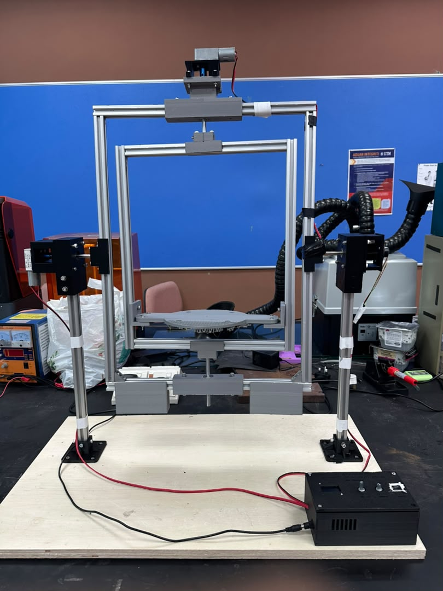
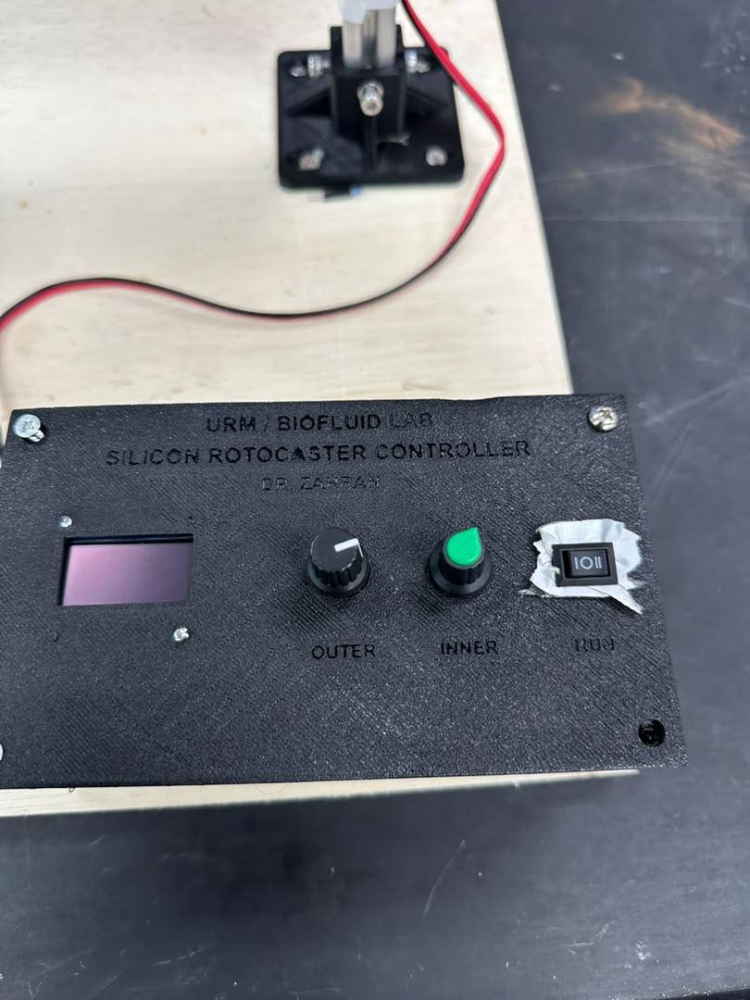
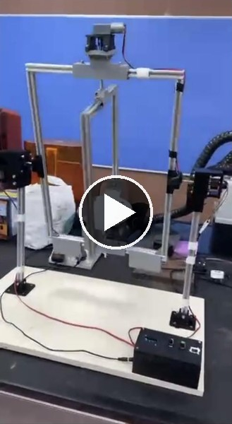

# Dual-Axis Silicone Rotocaster

Nested-box gimbal that turns a Ø300 × 300 mm mould through 360° about two perpendicular axes, with an Arduino controller. See [PROJECT_DETAILS.md](../PROJECT_DETAILS.md#project-2-dual-axis-rotocaster) for the full write-up.

| Machine | Controller |
|---|---|
|  |  |

**Video of the machine running, both axes turning:** 

## Files

| Folder | Contents |
|---|---|
| `docs/` | Technical report TR-BFL-ROT-01, SOP SOP-BFL-ROT-01 and the one-page visual SOP poster |
| `media/` | Video of the rotocaster running (1 min 3 s) |
| `firmware/rotocaster_controller/` | Arduino Uno sketch. Needs the **U8g2** library (Arduino IDE > Tools > Manage Libraries) |
| `cad/source/` | CadQuery (Python) parametric model. `rotocaster_v2.py` builds the machine; the other modules make the connector, lid, counterweight and slip-ring parts |
| `cad/printed-parts/` | STL of every printed part; the quantity is in the file name (`_x2` = print two) |
| `cad/control-box/` | Control box CadQuery script, body and lid STLs, STEP assembly, wiring and screw notes |
| `cad/screws_by_part.pdf` | Fastener list per part |
| `cad/rotocaster_3d_viewer.html` | Interactive 3D model: turn both axes with sliders, hover to name parts. Download and open in a browser |

## Print settings

PLA, 0.2 mm layers, 40 % infill, 6 walls on parts with bearing press fits. Print `00_bearing_fit_gauge_x1.stl` first and check which bore gives a firm 608ZZ fit. `08_mould_plate_REFERENCE_do_not_print.stl` is for reference only; the plate is printed in two halves.

## Controller hardware

Arduino Uno · L298N (ENA and ENB jumpers removed) · 1.3" 128×64 I2C OLED (SH1106) · 2 potentiometers · ON-OFF-ON rocker switch · 12 V adapter with 2 A fuse · 2 × JGY-370 12 V worm gearmotors · 6-wire slip ring for Motor 2.

> Run any new motor or wiring on a current-limited bench supply (about 0.5 A) first, and balance the frames before applying power. A stalled worm gearmotor burns out within seconds.
