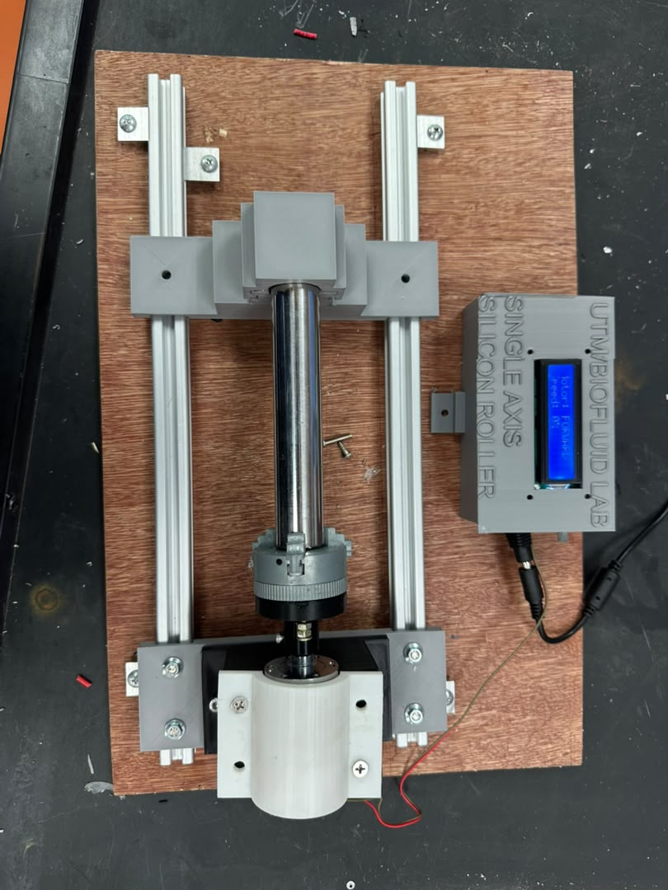
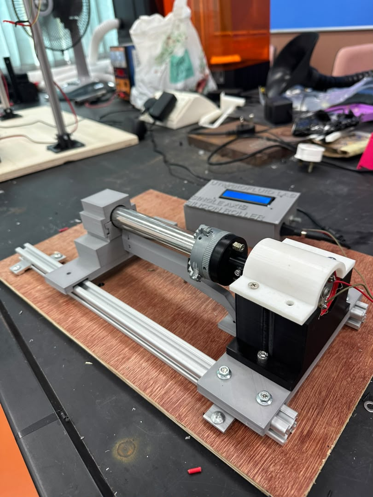
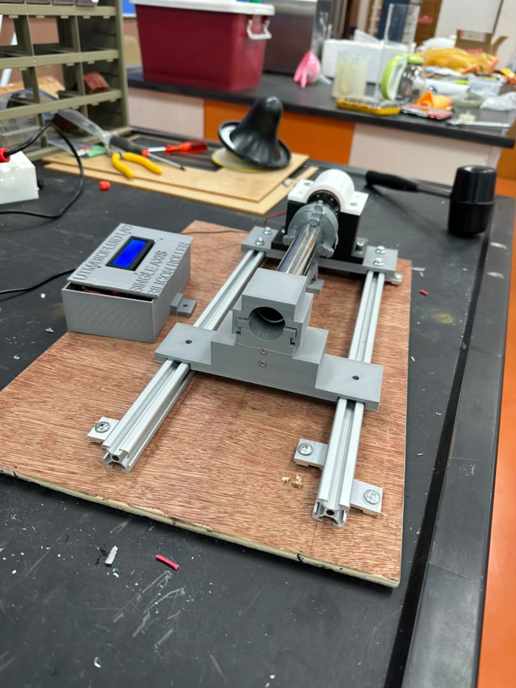

# Single-Axis Silicone Mould Roller

Upgraded single-axis roller for rotational casting of tubular silicone models. See [PROJECT_DETAILS.md](../PROJECT_DETAILS.md#project-1-single-axis-silicone-roller) for the full write-up.

| Top | Side | End |
|---|---|---|
|  |  |  |

## Files

| Folder | Contents |
|---|---|
| `docs/` | Technical report TR-BFL-RLR-01, SOP SOP-BFL-RLR-01 and the one-page visual SOP poster |
| `cad/hub_disc_D47_T10.stl` | Redesigned motor-to-roller hub disc (Ø47 × 10 mm, 6.2 mm D-bore, M3 grub screw) |
| `cad/MOTOR_SEAT_79x59_H56.stl` | Motor seat with cradle |
| `cad/hub_disc_parametric_tool.html` | Browser tool used to design the hub: sliders for every dimension, collision warnings, cut-away view, STL export. Open it in a browser. |

## Printing the hub disc

PLA, back face down (ring segments on the bed). Enable supports if the Ø29 mm bridge over the centre hollow sags. Drop the M3 nut into the side slot before fitting the shaft.
